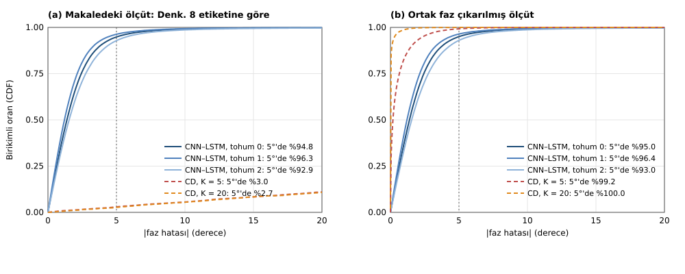
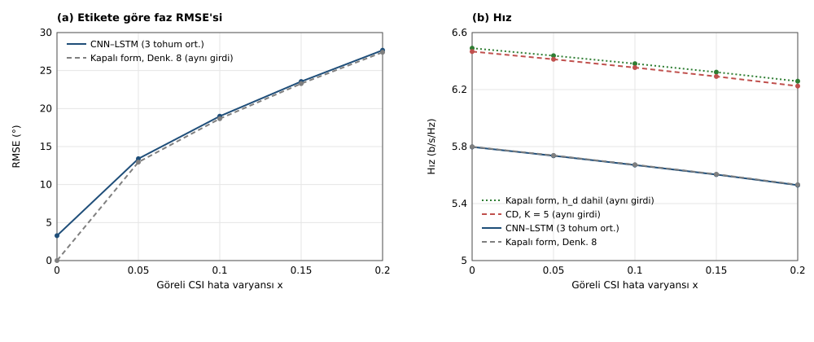

# Madde 8–14 ve 19: kod ve ham sonuçlarla kontrol raporu

22 Kasım 2026, dal `thesis/p4-deneyler`. Bu bir teknik rapor; tez metni değil (Kural 9). Her sayı aşağıda adı geçen betiğe ve ham çıktı dosyasına bağlı. MATLAB çalıştırılmadı (Kural 8). Makale 1 için kullanılan sayılar, daha önce onaylanan NumPy/PyTorch aktarımıyla alınmış **bağımsız bir çekilişten** geliyor; MATLAB'ın `rng(42)` örnekleriyle birebir aynı değil.

Not: tezin taslağı bu depoda yok. Şekil 6.1, 6.3 ve 6.6'yı içeriklerine göre eşleştirdim: 6.1 eğitim eğrisi, 6.3 hata CDF'i (makalede Şekil 8), 6.6 CSI hatasına gürbüzlük (makalede Şekil 10). Eşleşme yanlışsa söyle, ilgili satırı düzeltirim.

## 1) En üstte: Makale 1'in iddiasıyla çelişen bulgu (Kural 10)

Önerilen ölçütü (ortak faz kaymasından arındırılmış RMSE, min_φ RMSE(θ̂ + φ, θ*)) hesapladım. Mevcut eğitilmiş CNN–LSTM ağırlıkları kullanıldı; yeni eğitim yapılmadı. Bu ölçütte de, alınan hızda da **koordinat inişi (CD), CNN–LSTM'i geçiyor.**

| Yöntem | Makaledeki ölçüt (°) | Ortak faz çıkarılmış RMSE (°) | 5°'nin altındaki oran | Hız (b/s/Hz) | Optimuma göre kayıp |
| --- | --- | --- | --- | --- | --- |
| CNN–LSTM, tohum 0 | 3.18 | 3.13 | %95.0 | 5.797 | 0.693 |
| CNN–LSTM, tohum 1 | 2.77 | 2.72 | %96.4 | 5.797 | 0.693 |
| CNN–LSTM, tohum 2 | 3.90 | 3.85 | %93.0 | 5.797 | 0.694 |
| CD, K = 5 | 104.02 | **1.10** | %99.2 | **6.467** | 0.024 |
| CD, K = 20 | 104.50 | 0.25 | %99.98 | 6.488 | 0.003 |
| CD, K = 50 | 104.79 | 0.05 | %100 | 6.490 | 0.0002 |
| Optimum (h_d'yi hesaba katan) | 104.85 | 0.00 | %100 | 6.490 | 0 |

Test kümesi 6000 senaryo × 32 eleman. Kaynak: `audit/scripts/step8_invariant_rmse.py` → `audit/raw/step8_invariant_rmse.json`; veri `m1_data.generate(40000, seed=42)`, bölme tohumu 42; commit `e5af163`.

Ne anlama geliyor:
- **CD'nin 104°'si bir ölçüt hatası.** CD gerçek optimuma gidiyor; makalenin etiketi (Denklem 8) doğrudan bağlantıyı (h_d) yok sayıyor. İkisi arasında senaryo başına tek bir ortak faz farkı var. Bu fark çıkarılınca CD, K = 5'te bile CNN–LSTM'den yaklaşık 2.5–3.5 kat daha küçük hata veriyor.
- **CNN–LSTM'in hız kaybı (0.69 b/s/Hz) neredeyse tamamen (%99.7) ortak fazdan.** Ağ, etiketin şeklini iyi öğreniyor: ortak fazı h_d'ye hizalayan tek parametreli bir düzeltmeyle hızı 6.488 b/s/Hz'e çıkıyor, yani optimuma 0.002 kalıyor (aynı JSON, `rate_after_common_phase_fix_bpshz`). Bu düzeltme, ağın girdisinde olmayan h_d'yi kullanıyor; aynı bilgiyle optimum zaten kapalı formda hesaplanabiliyor (SPA ya da h_d'yi içeren etiket). Yani bu bir "ağ optimumu buluyor" sonucu değil, kaybın nereden geldiğinin teşhisi. Ama ağ yayımlandığı hâliyle etiketi öğrendiği için, etiketin kendisi kadar (5.799) hız veriyor.
- **Ortak faz, bu bağlantıda serbest değil.** h_d ≠ 0 olduğundan ortak faz, RIS yolunun doğrudan yola nasıl ekleneceğini belirliyor. Bu yüzden ortak fazdan arındırılmış RMSE tek başına yeterli değil, yanında hız da verilmeli. Tabloda ikisi birlikte var.

Tez için sonuç: "CNN–LSTM, CD, AO ve SPA'dan daha doğru" cümlesi bu ölçütle de, hızla da kurulamaz. Yayımlanan PSO, PGD ve "WMMSE" betiklerine karşı ise CNN–LSTM iki ölçütte de önde: ortak fazsız RMSE'leri 71.65 / 93.90 / 93.67°, hızları 5.527 / 2.891 / 3.003 b/s/Hz (`audit/raw/step2_baselines.json`). Ama bu üç betik zayıf uygulamalar: PGD ve "WMMSE" fazı neredeyse hiç hareket ettirmiyor. Kurulabilecek doğru cümleler:
- ağ, tek geçişli bir tahmin veriyor (CD ile gecikme karşılaştırması bu raporda yapılmadı; makaledeki gecikmeler farklı ölçüm türlerinden, bkz. Ek A);
- faz profilinin şeklini 3° civarında öğreniyor;
- kaybının neredeyse tamamı ortak fazdan geliyor; ortak faz h_d'ye sonradan hizalanınca optimuma 0.002 b/s/Hz kalıyor. Etiketi h_d'yi içerecek biçimde düzeltip yeniden eğitmek **ölçülmedi**.

Bu sonuncusu tezin değerlendirme protokolü fikriyle de uyumlu: doğru ölçüt faz hatası değil, hız.

## 2) Madde 19: Makale 2'deki statik küme. DÜZELTİLDİ.

**Koddaki gerçek bölme** (`thesis_exp/makale2_revizyon/veri_bolme/kontrol_bolme.py` → `veri_bolme.json`):

| Küme | Boyut | Kim kullanıyor |
| --- | --- | --- |
| Eğitim | 4200 | Öğrenilen güncelleme kuralı (`scripts/mumiso_unrolled.py`) |
| Doğrulama | 900 | Öğrenilen kural en iyi epoch'u ilk 500'de seçiyor. Adam'ın adım boyu ve amacı bunların ilk 400'ünde seçiliyor. |
| Test | 900 | Şekil 5'teki bütün sayılar ilk 600'de raporlanıyor (`mumiso_equal_step.py`, `mumiso_latency_parity.py`). |

- Bölme rastgele bir permütasyonla 70/15/15: `ris_mu/features.py:split_indices`, tohum 0. Üç küme ayrık; 400'lük küme 500'lüğün alt kümesi.
- Sonuç dosyalarının kayıtlı ayarı (`samples = 6000`, `eval_n = 600`, `val_n = 400`) ve beş checkpoint'in eğitim ayarı (`samples = 6000`) bununla tutuyor.
- Önerilen üç olasılıktan ikincisine yakın, ama tam olarak o değil. Eksik görünen 800 senaryonun:
  - **100'ü** yalnızca öğrenilen kuralın epoch seçiminde kullanıldı (doğrulamanın 401–500. senaryoları);
  - **700'ü** (doğrulamada 400, testte 300) ne seçimde ne makaledeki sayılarda kullanıldı. Not: eğitim betiği (`mumiso_unrolled.py`) 900 test senaryosunun hepsinde bir `test_min` değeri hesaplayıp `results/mumiso_eqstep_L*.json`'a yazıyor; bu değer hiçbir seçimde ve makalede kullanılmıyor.
- Yazım hatası yok; makale yalnızca eksik anlatıyordu. **Hiçbir sonuç sayısı değişmedi.**
- Birinci makalenin 6000 test senaryosu (40 000 × %15) ile bu 6000'in aynı olması gerçekten bir tesadüf. İki küme farklı üreteçlerden geliyor.

**Makaledeki değişiklik** (§V-A):
- Önce: "6000 scenarios without mobility, of which 4200 are used for training, 400 for validation and 600 for testing."
- Sonra: "6000 scenarios without mobility, split at random 4200/900/900 (training/validation/test); the learned update is validated on 500, Adam on 400 of these, and results use 600 test scenarios."

Makale 10 sayfaya taştığı için dört cümle, bilgi kaybı olmadan kısaltıldı (`DEGISIKLIKLER.md`, 18. tur). Makale yine 9 sayfa ve 46 kaynak. İddia denetleyicileri 126/126 ve 120/120.

## 3) Birinci makale, madde 8–14

Yayımlanmış makale değiştirilmedi (değiştirilemez). Aşağıdaki tablo, her madde için kodun ne gösterdiğini ve tezde ne yapılabileceğini veriyor. Kaynaklar:
- `aisy_paket/orijinal/` (dokunulmadı);
- `audit/AUDIT_REPORT.md` ve ham dosyaları (12 Kasım bağımsız denetimi);
- bugünkü `step8` betikleri.

### Madde 8: klasik yöntemler (en kritik)

Koddan okunanlar (`ris_CD.m`; diğerleri denetimin satır satır aktardığı `ris_AO/PGD/PSO/SPA/WMMSE.m`, `audit/scripts/step2_baselines.py`):

| Yöntem | Amaçta h_d var mı? | Başlangıç | Faz araması | Durma |
| --- | --- | --- | --- | --- |
| CD | Var: \|h_d + Σ G_n F_n e^{jθ_n}\| | Bütün fazlar 0 | Her eleman için kapalı form, sürekli (ızgara yok), [−π, π)'ye sarılı | Sabit K tarama (K = 5); yakınsama testi yok |
| AO | Var | 0 | CD ile **aynı** algoritma | Varsayılan K = 1 |
| SPA | Var | h_d'den başlar | Elemanları sırayla hizalar, tek geçiş | Tek geçiş |
| PGD | Var | 0 (z = 1) | Gradyan adımı 0.2, birim modüle izdüşüm | Sabit 50 yineleme |
| "WMMSE" | Var | 0 | Eleman başına tek gradyan adımı (0.1); adı WMMSE ama algoritma WMMSE değil | 1 yineleme |
| PSO | Var (uygunluk = alınan güç) | Rastgele, tekdüze | 20 parçacık | Sabit 30 yineleme |

- **Bütün klasik yöntemler h_d'yi kullanıyor; etiket kullanmıyor.** CD, AO ve SPA'yı RMSE'nin cezalandırmasının nedeni bu: üçü de h_d'ye hizalı optimuma gidiyor (SPA tam optimumu veriyor). PSO, PGD ve "WMMSE" ise optimuma ulaşmadığı için ortak faz çıkarılsa da kötü.
- Yayımlanan kodla CD, AO, PSO ve SPA'nın makaledeki ölçütle RMSE'si 103.8–104.9°. Makaledeki 3.50 / 3.50 / 4.50 / 5.00° bu kodla **ÜRETİLEMEDİ** (`audit/raw/step2_baselines.json`).
- AO ile CD aynı algoritma olduğu hâlde makalede farklı ± ve süre değerleri var (±1.38 / ±1.42; 0.18 / 0.15 ms). K = 5'te aynı algoritmanın aynı veride farklı ± vermesi, ikisinin aynı koşudan gelmediğini gösteriyor. Süre farkı ise zamanlama gürültüsünden de gelebilir.
- PGD ve "WMMSE" betikleri fazı neredeyse hiç hareket ettirmiyor: alınan güç etiketin 10.3 ve 9.9 dB altında.

Tezde ne olur: yöntem bölümüne yukarıdaki tabloyu özetleyen 3–4 cümle girer. Eleştirel alt bölüm **güçlenir**, çünkü 1. bölümdeki ölçüm doğrudan cevap veriyor.

### Madde 9: Şekil 6.1 (eğitim eğrisi)

`theta_NN_multioutput.m`, eğrileri MATLAB'ın `'Plots','training-progress'` penceresiyle çiziyor. Bu pencerenin özellikleri:
- **Yatay eksen yineleme, epoch değil.** 28 000 / 256 ≈ 109 yineleme bir epoch ediyor.
- Doğrulama her 50 yinelemede bir hesaplanıyor.
- Üst panelde "RMSE", alt panelde kayıp var. Buradaki RMSE, ağın **sin/cos çıktısının** RMSE'si: birimsiz, derece değil. Kayıp ise yarım-MSE.
- `trainNetwork` çağrısı eğitim bilgisini (`info`) kaydetmiyor. Eğrinin sayısal değerleri sonradan çıkarılamaz; yalnızca ekran görüntüsü var.

Tezde ne olur: eksen "yineleme" ve "RMSE (sin/cos çıktısı, birimsiz)" olarak etiketlenir. Metin derece cinsinden faz hatasından söz ediyorsa, şekle değil test RMSE'sine bağlanır. Şekil "RMSE (°)" ya da "epoch" diyorsa yanlıştır.

### Madde 10: Şekil 6.3 (CDF)

- Yayımlanan şeklin çizim betiği yok. `plot_results.m`'deki CDF bölümü yayımlanan görüntüyle uyuşmuyor (`audit/raw/step0_step3_notes.md`).
- Görüntüden okunan değerler: 5°'de CDF ≈ 0.87; "5°" etiketli kesikli çizgi aslında x ≈ 6.7°'de.
- Bağımsız yeniden üretimde 5°'de CDF %92.9 / %94.8 / %96.3 (3 tohum), %95'e ulaşılan hata 4.4–5.8°. Metindeki "%95'i 5°'nin altında" ifadesi yeniden üretimle uyumlu; **yayımlanan görüntü uyumlu değil.**
- Gerçek veriden çizilmiş yeni şekil: `audit/raw/step8_cdf.svg` (`audit/scripts/step8_cdf_plot.py`).
  - Panel (a), makaledeki ölçütle.
  - Panel (b), ortak faz çıkarılmış ölçütle, CD dahil.
- Birebir MATLAB eğrisi için `cnn_lstm_test_results.mat` dosyası gerekiyor. Betik `phase_err` değişkenini bu dosyaya kaydediyor. Sende varsa gönder; eğriyi o veriden yeniden çizerim. Dosya v7.3 biçiminde, okumak için h5py kurmam gerekecek.



*Şekil. |Faz hatası| CDF'i, bağımsız Python yeniden üretimi (6000 test senaryosu × 32 eleman). (a) Makaledeki ölçüt; CD burada 5°'de %3 gösteriyor, çünkü etiket h_d'yi yok sayıyor. (b) Ortak faz çıkarılmış ölçüt; CD her K'de CNN–LSTM'in solunda.*

Tezde ne olur: ya `.mat` dosyasından birebir çizilir, ya da yeni şekil "bağımsız Python yeniden üretimi" diye açıkça etiketlenerek kullanılır.

### Madde 11: 3.95° çakışması

3.95° iki yerde geçiyor:
- Tablo 1: "doğrudan faz tahmini", aynı mimari olduğu söyleniyor;
- Tablo 6: "FC-DNN (doğrudan) 3.95 ± 1.71".

Doğrudan faz için sayı üreten tek kod, `transformer_baseline.m` içindeki 512-512-256 FC-DNN (MLP). Tablo 1'deki "aynı mimari, doğrudan çıkış" için hiçbir sürümde kod yok. Yani iki satır büyük olasılıkla **aynı FC-DNN koşusu**, ve Tablo 1'deki "aynı mimari" ifadesi kodla desteklenmiyor.

Ek tutarsızlık: FC-DNN için üç farklı değer var.
- Tablo 3: "FC-DNN only" 4.73°;
- Tablo 6: FC-DNN (sin/cos) 3.41°;
- Tablo 6: FC-DNN (doğrudan) 3.95°.

Bağımsız yeniden üretimde FC-DNN (doğrudan) 83.85° verdi, yani tamamen başarısız oldu (`audit/raw/train/fcdnn_direct_N32_s0.json`).

Tezde ne olur: Tablo 1'in satırı "FC-DNN (doğrudan faz)" diye adlandırılmalı. Daha iyisi, tezin kendi **aynı mimarili** karşılaştırması kullanılmalı (`TEZ_YAZIM_REFERANSI.md` §6.4, `results/sumiso_representation.json`): SISO'da sin/cos 14.63° ± 0.38, açı + 1−cos kaybı 21.35°, açı + düz MSE 30.33°. sin/cos üç tohumun üçünde de en düşük RMSE'yi veriyor. Bu, sin/cos katkısını kodu olan bir deneyle destekliyor.

### Madde 12–13: ablasyon (Tablo 3)

- Varyant mimarilerinin (CNN-only, LSTM-only, 1L+1L, 3L+2L, 2L+3L) **hiçbiri** hiçbir kod sürümünde tanımlı değil. Bu 6 satırın RMSE ve parametre değerleri **ÜRETİLEMEDİ**.
- **Parametre sayıları kendi içinde tutarsız.**
  - Önerilen modelin 727 360'ı, makaledeki analitik toplam. Bu toplam 565 696 parametrelik bir FC bloğu içeriyor, ama koddaki modelde bu blok yok. Kodun gerçek sayısı 161 794 (MATLAB) / 162 562 (PyTorch aktarımı; 768'lik fark, PyTorch'un iki LSTM katmanında taşıdığı ek yanlılık vektörlerinden: 4·128 + 4·64).
  - Daha derin varyantlar (231 K, 213 K), aynı FC bloğunu taşıyorlarsa 727 K'dan küçük olamaz.
  - "CNN-only" (680 K), "LSTM-only"den (520 K) büyük görünüyor; oysa CNN bloğu yalnızca 13 440 parametre.
  - Kaynak: `audit/raw/step3_sources.json`.

Tezde ne olur: parametre sütunu ya çıkarılır, ya da yalnızca kodu olan iki model için koddan sayılan değerle verilir (CNN–LSTM 161 794; CNN-Transformer 17 442, `transformer_baseline.m`'nin PyTorch aktarımından sayıldı). Ablasyon satırları ya çıkarılır ya da "betiği bulunamadı" notuyla verilir. Not bırakmak yerine çıkarmayı öneririm.

### Madde 14: Şekil 6.6 (CSI hatasına gürbüzlük)

- Yayımlanan şeklin x ekseni "CSI Error Variance (σ²)", metin ise "%10 CSI hatası" diyor.
- Görüntüden okunan değerler: σ² = 0.10'da ≈ 3.5°; metindeki 4.2° ise σ² = 0.15'te.
- **Hiçbir kod sürümünde CSI hatası kodu ve hata modeli tanımı yok.** Yayımlanan eğri ÜRETİLEMEDİ.
- Varsayılan bir modelle (eleman başına göreli hata varyansı; varsayım raporda açıkça yazılı) σ² = 0.10'da model 19.0°, aynı girdiyle kapalı form 18.66° veriyor. Yani üstünlük yok (`audit/raw/step6_eval.json`, `step2_baselines.json`).

Tezde ne olur: şekil ya çıkarılır, ya da hata modeli açıkça tanımlanmış yeniden üretimle değiştirilir. Tezin kendi kusurlu CSI deneyleri ön kayıtlı ve ayrıca var (`ON_KAYIT_KISMI_CSI.md`, `TEZ_YAZIM_REFERANSI.md` §6.7).

## 4) Özet tablo

| Madde | Durum | Önerilen işlem |
| --- | --- | --- |
| 19 (Makale 2) | Kod okundu, kesin | Makalede düzeltildi; sayılar değişmedi |
| 8 | Kod okundu, kesin; ölçüldü | Uygulama paragrafı ve 1. bölümdeki tablo |
| 9 | Kod okundu, kesin | Eksen etiketleri: yineleme, birimsiz sin/cos RMSE |
| 10 | Betik yok; yeniden üretim var | `.mat` gelirse birebir; yoksa etiketli yeni şekil |
| 11 | Kod okundu | Satır "FC-DNN (doğrudan)"; tezin §6.4'ü kullanılsın |
| 12–13 | ÜRETİLEMEDİ (kod yok); parametreler tutarsız | Çıkarılsın ya da yalnızca kodu olanlar |
| 14 | ÜRETİLEMEDİ (kod ve model tanımı yok) | Çıkarılsın ya da tanımlı yeniden üretim |

## 5) Onaydan sonra yapılanlar (22 Kasım 2026)

Şekil eşleşmesi onaylandı: 6.1 eğitim eğrisi, 6.3 CDF, 6.6 CSI gürbüzlüğü.

**1. Tez için hazır tablo ve şekiller** (`thesis_exp/makale_kontrol/tez_ekleri/`, `make_tez_ekleri.py`)
- Yeni ölçüm yok; her sayı ham bir dosyadan okunuyor ve kaynağı dosyanın altında yazılı.
- Tablolar `.tex` (booktabs) ve `.md`, şekiller SVG, PDF ve PNG.

| Dosya | Madde | İçerik |
| --- | --- | --- |
| `T2_klasik` | 8 | Klasik yöntemlerin koddaki uygulaması |
| `T3_ortak_faz` | 8 | Ortak fazsız RMSE ve hız (1. bölümdeki tablo) |
| `S1_cdf` | 10 | Gerçek yeniden üretim verisinden CDF |
| `T1_gosterim` | 11 | Aynı mimaride sin/cos ve doğrudan açı (Tablo 1'in yerine) |
| `T4_parametre` | 12–13 | Koddan sayılabilen parametreler |
| `S2_csi`, `T5_csi` | 14 | CSI gürbüzlüğü, hata modeli açıkça tanımlı (Şekil 6.6'nın yerine) |



*Şekil. CSI hatasına gürbüzlük (bağımsız Python yeniden üretimi; hata modeli F̂ = F + √(x\|F_n\|²)·CN(0,1), Ĝ aynı).*
- (a) Etikete göre RMSE: CNN–LSTM, aynı bozuk girdiyle kapalı formdan her noktada biraz kötü.
- (b) Hız: CD ve h_d'yi içeren kapalı form (ikisi de aynı bozuk girdiyle), CNN–LSTM'in her hata düzeyinde yaklaşık 0.7 b/s/Hz üstünde.
- Makaledeki "CSI hatasında kapalı formdan belirgin üstünlük" iddiası bu modelle desteklenmiyor.

Kontrol: `T1_gosterim`'deki std değerleri ilk denemede kendi hesabımla 0.31 çıktı; `TEZ_YAZIM_REFERANSI.md` 0.38 diyordu. Fark popülasyon ve örneklem std'sinden geliyordu. Tablo artık JSON'da kayıtlı değeri (örneklem std) okuyor ve referansla birebir aynı.

**2. `.mat` okuyucusu hazır** (`audit/scripts/step9_mat_cdf.py`)
- `cnn_lstm_test_results.mat` (v7.3) dosyasını okuyor ve şunları veriyor:
  - RMSE, SR@1/3/5/10°, 5°'de CDF ve %95 hata;
  - THETA_pred ve THETA_true varsa ortak fazsız RMSE;
  - birebir MATLAB CDF şekli.
- Bilinen sonuçlu sentetik bir v7.3 dosyasıyla sınandı: RMSE birebir tuttu.
- Dosyayı gönderdiğinde tek komutla çalışıyor: `python3 audit/scripts/step9_mat_cdf.py <dosya>`.

**3. Danışman görüşmesi için düzeltme listesi:** aşağıda Ek A.
- Bu bir teknik liste; düzeltme metni değil.
- Derginin düzeltme sürecine başvurup başvurmamak senin, danışmanının ve ortak yazarların kararı. Ben dergiye bir şey göndermedim, gönderemem de.

## 6) Hâlâ senden gelecek olan

1. `cnn_lstm_test_results.mat`, varsa. Gelince CDF birebir çizilir ve `S1_cdf` onunla değiştirilir.
2. Ek A'nın danışmanla görüşülmesi.

## 7) Double check (22 Kasım 2026)

**Benim yaptığım kontroller**
- Bütün betikler yeniden koşturuldu. Sayılar ve altı tablo birebir aynı çıktı: betikler deterministik.
- Ortak fazsız RMSE ikinci bir yöntemle sınandı: 3601 noktalı ızgarada gerçek en küçük arandı. CNN–LSTM için 2.724° ve 2.725°, CD için 1.100° ve 1.100° çıktı; formül doğru.

**Bağımsız denetim** (`DENETIM_BAGIMSIZ.md`): denetçi, benim sonuçlarımı görmeden, raporu ham dosyalarla ve orijinal kodla karşılaştırdı.
- KRİTİK bulgu yok. Uydurulmuş ya da kaynaksız sayı yok. Makale 2'deki yeni cümle koda göre birebir doğru.
- Dört ORTA ve on KÜÇÜK bulgu çıktı; hepsi ifade gücü ve etiketle ilgili. Uygulananlar:

| Bulgu | Düzeltme |
| --- | --- |
| "Klasik yöntemler" genellemesi fazla geniş | Çelişki CD, AO ve SPA ile sınırlandı. Yayımlanan PSO, PGD ve "WMMSE" betiklerine karşı CNN–LSTM'in önde olduğu sayılarıyla eklendi. |
| "Etiket düzeltilirse optimuma yaklaşır" ölçülmemişti | "Ölçülmedi" diye işaretlendi; yalnızca ölçülen sonradan hizalama bırakıldı. |
| Ortak faz düzeltmesi h_d kullanıyor | Bunun bir teşhis olduğu, "ağ optimumu buluyor" sonucu olmadığı yazıldı. |
| Nicemleme satırı fazla kesindi | "Sürekli etikete karşı RMSE tanımıyla imkânsız" diye daraltıldı. |
| "700'ü hiç kullanılmadı" | Eğitim betiği 900 test senaryosunun hepsinde bir değer yazıyor, ama hiçbir yerde kullanılmıyor; ifade buna göre düzeltildi (rapor ve `DEGISIKLIKLER.md`). |
| "Tamamen ortak fazdan" | "Neredeyse tamamen (%99.7)". |
| T3'te %100.0 (ham değer 0.99984) | İki ondalığa çıkarıldı: %99.98. |
| T5 ve S2'de "optimum" etiketi | Bozuk CSI'dan hesaplandığı için "kapalı form, h_d dahil" diye adlandırıldı. |
| T4'te kaynak etiketi; 768'lik farkın açıklaması | PyTorch aktarımı diye işaretlendi; fark iki LSTM katmanının ek yanlılık vektörlerinden (4·128 + 4·64). |
| AO değeri K = 1'de hesaplanmış | Ek A'ya K = 5'te CD ile aynı olduğu (104.02°) eklendi. |
| AO/CD süre farkı | Gürültüden de gelebileceği yazıldı; kanıt olarak yalnızca ± farkı kullanıldı. |
| Makale 2, iki küçük anlam kaybı | Yükün ölçümden önce alındığı bilgisi geri getirildi ("from a load average of 0.45"). Makale yine 9 sayfa. "most are repeated" ifadesini netleştirmek sayfayı taşırdığı için bırakıldı; anlam bağlamdan açık. |

Kalan bilgi notları:
- "Yatay eksen yineleme" ve "yarım-MSE" iddiaları kod değil MATLAB belgelerine dayanıyor; MATLAB olmadan doğrulanamaz.
- Şekil 5(b)'nin zamanlamaları ayrı bir küçük çekilişten, tek senaryoda ölçülüyor (bu düzenlemeden önce de böyleydi). Gecikme veriden bağımsız olduğu için etkisi yok.
- CDF'in ham hata dosyası depoya konmadı (7 MB); betik yaklaşık 40 saniyede yeniden üretiyor.

Son durum: `audit_claims.py --all` 126/126, `check_claims.py` 120/120, Makale 2 9 sayfa.

## Ek A: Makale 1'de yeniden üretilemeyen ya da çelişen değerler

Bütün "kod sonucu" sütunu bağımsız Python çekilişinden geliyor (MATLAB değil). Kaynaklar: `audit/AUDIT_REPORT.md` ve `audit/raw/`; ortak fazsız değerler `audit/raw/step8_invariant_rmse.json`.

| Yer | Yayımlanan | Kod sonucu | Durum |
| --- | --- | --- | --- |
| Denk. 8 etiketi | Alınan gücün optimumu | h_d'yi içeren etiket ortalama 2.20 dB daha fazla güç alıyor | Çelişiyor |
| Tablo 6, CD (K = 5) | 3.50° | 104.02°; ortak fazsız 1.10° | Üretilemedi; ölçüt hatası |
| Tablo 6, AO / PSO / SPA | 3.50 / 4.50 / 5.00° | 103.75 (varsayılan K = 1; K = 5'te CD ile aynı, 104.02) / 104.15 / 104.85° | Üretilemedi |
| Tablo 6, PGD / WMMSE | 4.00 / 4.00° | Faz neredeyse hareket etmiyor (−10.3 / −9.9 dB) | Üretilemedi |
| CNN–LSTM ve CD/AO/SPA karşılaştırması | CNN–LSTM daha doğru | Ortak fazsız 2.72–3.85° ve 1.10° (CD); hız 5.797 ve 6.467 (CD), 6.490 (SPA) | Çelişiyor (PSO/PGD/WMMSE betiklerine karşı CNN–LSTM önde) |
| Tablo 1, doğrudan faz | 3.95° (aynı mimari) | Tek kod FC-DNN; o da 83.85° | Kod yok / çelişiyor |
| Tablo 3, ablasyon | 6 varyant, 89–680 K | Varyantlar tanımlı değil | Üretilemedi |
| Parametre sayısı | 727 360 | 161 794 (MATLAB), 162 562 (PyTorch) | Çelişiyor |
| Şekil 8 (CDF) | Görüntüde 5°'de ≈ %87 | %92.9–96.3 (metindeki %95 ile uyumlu) | Görüntü çelişiyor |
| Şekil 10, %10 CSI | 4.2°, kapalı formdan üstün | 19.0°; kapalı form 18.66° | Kod yok / çelişiyor |
| 1/2/3 bit nicemleme | 4.12 / 3.08 / 2.81° | 52.06 / 26.17 / 13.39° (etiketin kendisi nicemlenince 51.95 / 25.98 / 12.98°) | Sürekli etikete karşı RMSE tanımıyla imkânsız |
| Gecikme N = 32 | 0.08 ms | 0.80 ms (tek örnek, CPU; makale toplu iş, GPU) | Farklı ölçüm |
| 5 koşu GA | ±0.07–0.09° | 3 tohumda std 0.58° | Çelişiyor |
| Kaynakça | 64 kaynak | 7'si hiçbir kayıtta yok, 1'i geri çekilmiş | Çelişiyor |

## Yeniden üretim

```
python3 thesis_exp/makale2_revizyon/veri_bolme/kontrol_bolme.py   # madde 19, < 5 s
python3 audit/scripts/step8_invariant_rmse.py                      # bölüm 1, ~40 s, tek iş parçacığı
python3 audit/scripts/step8_cdf_plot.py                            # madde 10 şekli
python3 thesis_exp/makale_kontrol/tez_ekleri/make_tez_ekleri.py    # tez ekleri
python3 audit/scripts/step9_mat_cdf.py <cnn_lstm_test_results.mat> # .mat gelince
```
Tohumlar: veri 42, bölme 42 (Makale 1 aktarımı); statik küme bölmesi 0, senaryo 11 (Makale 2). Eğitim yok; zamanlama ölçümü yok.
